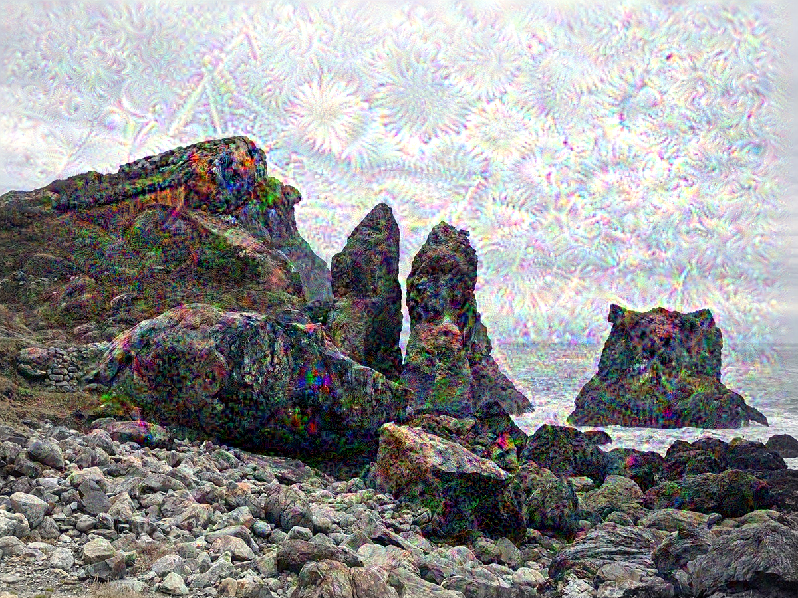

# Generative Deep Learning

Using a trained network to create images instead of classifying them.



## DeepDream

`deep_dream.py` takes a photo and changes it so that it strongly activates certain layers of **InceptionV3** (pretrained on ImageNet). The network "sees" patterns in the image and amplifies them, producing the dream-like textures above.

**How it works:**

1. Pick a few layers (`mixed4` to `mixed7`), each with a weight for how much it contributes.
2. The loss is the weighted average of the squared activations of those layers.
3. Instead of changing the weights, change the **image**: gradient **ascent** on the pixels to increase the loss.
4. Process the image at 3 scales ("octaves"), from small to large, and add back lost detail after each upscale, so the patterns appear at different sizes.

## Run it

```bash
pip install tensorflow matplotlib numpy
python deep_dream.py   # downloads a sample photo and saves dream.png
```

## What I learned

- Gradient ascent on the input image instead of gradient descent on the weights.
- What different depths of a CNN respond to: shallow layers see edges and textures, deeper layers see shapes and objects.
- Multi-scale processing to keep the result detailed.

## Credits

Based on *Deep Learning with Python* by François Chollet (Manning).
