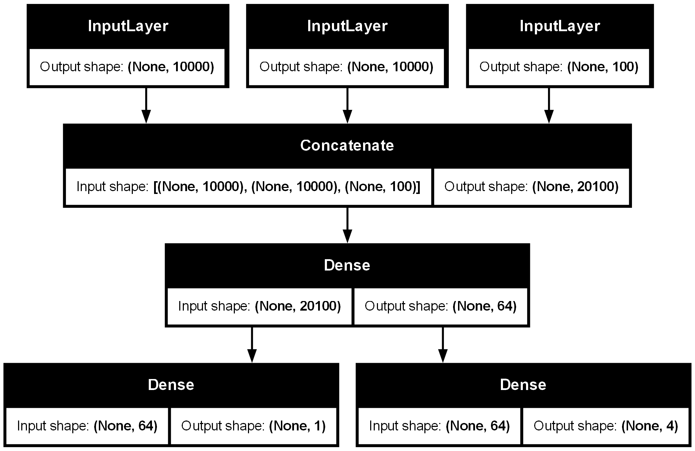

# Keras Fundamentals

My first steps with Keras and TensorFlow: building, training and saving neural networks, and the different ways Keras lets you define a model.

## Scripts

| File | What it does |
|---|---|
| `mnist_first_network.py` | A first neural network: classifies handwritten digits (MNIST) with 2 Dense layers, then saves the model |
| `mnist_predict.py` | Loads the saved model, predicts the first test digits and reports test accuracy |
| `linear_classifier_from_scratch.py` | A linear classifier written with raw TensorFlow (`tf.Variable`, `GradientTape`), no Keras layers, on 2 synthetic point clouds. Plots the decision line |
| `sequential_api.py` | Builds a model with the Sequential API and prints its weights and summary |
| `functional_api.py` | A multi-input, multi-output model with the Functional API (support ticket: title, text and tags in, priority and department out), then extends it with a new "difficulty" output. Saves model diagrams |
| `mnist_callbacks_tensorboard.py` | A deeper MNIST model trained with callbacks: early stopping, saving the best model and TensorBoard logging |



## Key ideas

- **Training loop from scratch:** forward pass, loss, gradients with `GradientTape`, weight update. This is what `model.fit()` does for you.
- **Sequential vs Functional API:** a simple stack of layers vs any graph of layers, with multiple inputs and outputs and the ability to reuse parts of a model.
- **Callbacks:** stop when validation loss stops improving, keep only the best model, and watch training live in TensorBoard.

## Run it

```bash
pip install tensorflow matplotlib pydot
python mnist_first_network.py     # trains and saves mnist_model.keras
python mnist_predict.py           # uses the saved model
python mnist_callbacks_tensorboard.py
tensorboard --logdir logs         # open the training dashboard
```

`plot_model` in `functional_api.py` also needs [Graphviz](https://graphviz.org/download/) installed.

## What I learned

- What a tensor, a layer, a loss and an optimizer actually are, by writing a training step by hand.
- When to use Sequential and when to use the Functional API.
- How callbacks make training safer (no overfitting past the best epoch) and easier to inspect.
